# 🧭 AgentGrid: Project Explanation

> **What this document is:** a visual walkthrough of AgentGrid: the problem it solves, how it was designed and built, how every screen works, how each conversation flows through the system, and how to test it yourself.
> Diagrams render on GitHub and in VS Code's Markdown preview (Mermaid).

---

## 📑 Contents

1. [The problem (RFP) in one picture](#1--the-problem-rfp-in-one-picture)
2. [What AgentGrid is](#2--what-agentgrid-is)
3. [How each RFP requirement is addressed](#3--how-each-rfp-requirement-is-addressed)
4. [Our approach and key decisions](#4--our-approach-and-key-decisions)
5. [System architecture](#5--system-architecture)
6. [The demo world: workspaces, agents and websites](#6--the-demo-world)
7. [Demo accounts and passwords](#7--demo-accounts-and-passwords)
8. [The console, tab by tab](#8--the-console-tab-by-tab)
9. [The full customer journey (end to end)](#9--the-full-customer-journey-end-to-end)
10. [The AI agent: how one reply is produced](#10--the-ai-agent-how-one-reply-is-produced)
11. [Every conversation flow, explained](#11--every-conversation-flow-explained)
12. [Platform flows: tenants, branding, privacy, workflows](#12--platform-flows)
13. [Data model](#13--data-model)
14. [Analytics: what each number means](#14--analytics-what-each-number-means)
15. [Security in one table](#15--security-in-one-table)
16. [From PoC to scale](#16--from-poc-to-scale)
17. [🧪 How to test everything yourself](#17--how-to-test-everything-yourself)
18. [Code map: where each thing lives](#18--code-map-where-each-thing-lives)
19. [Honest limitations](#19--honest-limitations)

---

## 1. 🎯 The problem (RFP) in one picture

**RFP:** TTG-AI-AGENTGRID by The Talent Grid. *"AgentGrid: AI-Powered Customer Engagement & Business Automation Platform."*

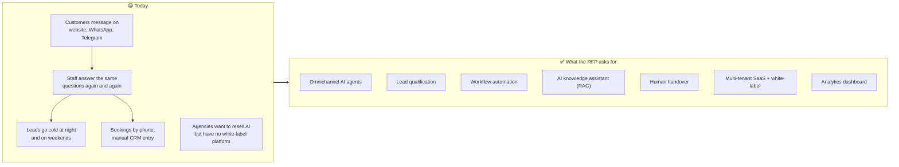

**Who the RFP cares about:**

| Stakeholder | Their pain | What they need |
|---|---|---|
| 🏢 Small and medium businesses | Repetitive chats, slow replies, lost leads | 24/7 answers, qualified leads, bookings |
| 🧑‍💼 Agencies / resellers | No way to brand and resell AI | White-label, many clients from one place |
| 🏛️ Enterprise teams | Data must reach CRM and analytics | Integrations, APIs, reporting |
| 🙋 End customers | Waiting, repeating themselves | Fast, correct answers on their channel |
| 🛠️ Developers / SRE | Hard to operate | Observability, clean deploys |
| ⚖️ Compliance | Privacy and isolation | Isolation, data masking, audit |

**Evaluation criteria:** Functionality · AI Quality · Scalability · Security · Enterprise Readiness.

---

## 2. 🤖 What AgentGrid is

> **AgentGrid is a multi-tenant platform where businesses (or agencies on their behalf) create AI agents that talk to customers on web chat, WhatsApp, Telegram and API. The agents answer from the business's own documents, qualify and score leads, recommend products, book appointments, trigger business workflows, and hand over to a human when needed, all visible in one console with analytics.**

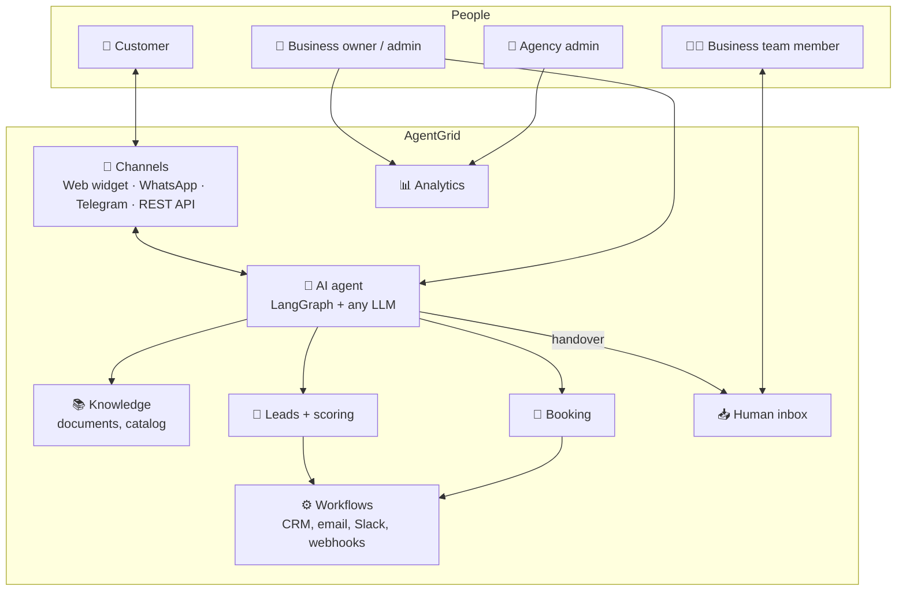

---

## 3. ✅ How each RFP requirement is addressed

| # | RFP capability | How AgentGrid does it | Where you see it |
|---|---|---|---|
| 1 | **Omnichannel AI agents** | One agent serves a web widget (one `<script>` tag), WhatsApp Cloud API, a Telegram bot and a REST API. Every channel is normalised into the same pipeline | Demo websites · Agents → Channels · Channel simulator |
| 2 | **Lead qualification** | The LLM extracts fields through a typed `update_lead` tool; **code** (not the AI) scores them with template weights and sets the stage | Leads page · Inbox lead card · Playground trace |
| 3 | **Workflow automation** | Events (lead qualified, appointment booked, escalated…) trigger workflows: CRM sync, HubSpot, email with calendar invite, Slack, webhooks, delays, conditions, follow-up messages | Workflows · Run history · Email outbox |
| 4 | **AI knowledge assistant (RAG)** | Documents are split, embedded locally and searched with hybrid vector + keyword search. Answers cite sources; fake citations are removed; unsure answers are admitted | Agents → Knowledge · source line under replies |
| 5 | **Human handover** | Keyword, sensitive topic, two unsure answers in a row, or the AI's own decision → the conversation moves to the inbox with an AI summary; humans claim, reply, return it to the AI or resolve it | Inbox |
| 6 | **Multi-tenant SaaS** | Platform → agency → client hierarchy, database row-level security, 5 roles, white-label branding, templates, API keys, audit log | Workspace switcher · Clients · Settings |
| 7 | **Analytics dashboard** | Conversations, automated resolution, escalation, response time, funnel, bookings, CSAT, model cost, per agent / human / channel, agency roll-up | Dashboard |
| ➕ | **Bring your own model** | Any provider per workspace or agent (OpenAI, Anthropic, Qwen, OpenRouter, private Ollama), with fallback; offline demo model when no key | AI models · Agent settings |
| ➕ | **AI quality proof** | 28 scripted conversations checked automatically → report | `docs/EVAL_REPORT.md` |

---

## 4. 🧠 Our approach and key decisions

### The guiding idea: *deterministic shell, AI core*

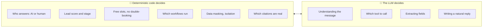

> [!TIP]
> **Why?** LLMs are great at language but unreliable at rules. Scoring, booking and state changes must be repeatable and auditable, so they live in code. The pre-read asks for exactly this mix of deterministic logic and LLMs.

### Decisions and the reasons for them

| Decision | Why |
|---|---|
| **LangChain + LangGraph** for the agent | Works with any LLM provider; the agent is an explicit graph you can draw, test and explain |
| **FastAPI + PostgreSQL only** in the PoC (no Kafka/Redis in code) | One command to run, few failure points, deploys in minutes. Kafka, Redis, Temporal and Airflow are designed in at clear swap points ([§16](#16--from-poc-to-scale)) |
| **Postgres does everything**: data, vectors (pgvector), keyword search, job queue | Fewer services; row-level security protects vectors too |
| **Provider-agnostic models + offline demo model** | Agencies pick their model. The live demo never breaks without a key |
| **Personal data masked before the AI sees it** | Privacy by design; phone numbers never leave in prompts |
| **Industry templates** (real estate, clinic, e-commerce, SaaS) | Onboard a new client in a minute |
| **Vercel (console) + Render (API)** | Free HTTPS, simple deploys, kept separate as requested |
| **Honesty**: what's real vs simulated is written down | Evaluators trust candour |

---

## 5. 🏗️ System architecture

### What is deployed where

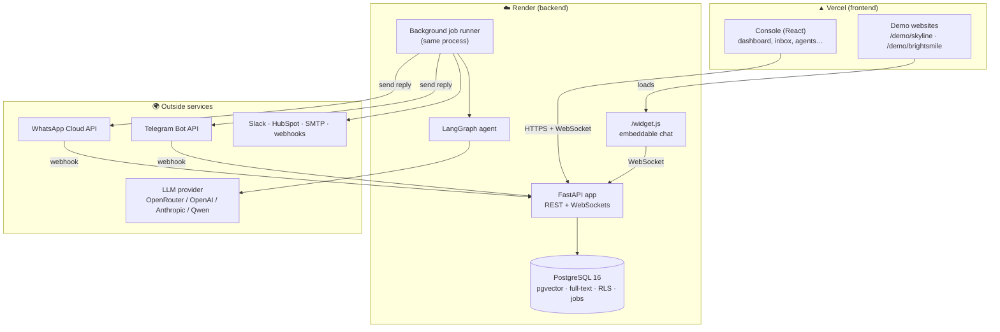

### Inside the backend

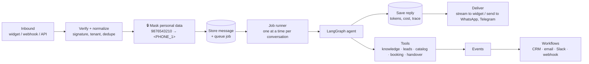

---

## 6. 🌍 The demo world

### Workspace hierarchy (multi-tenancy)

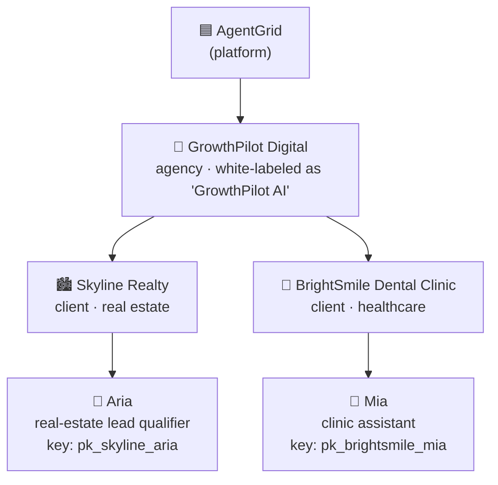

| | 🏙️ Skyline Realty, agent **Aria** | 🦷 BrightSmile Dental Clinic, agent **Mia** |
|---|---|---|
| Template | Real Estate Lead Qualifier | Healthcare Clinic Assistant |
| Knowledge | Projects brochure, pricing & payment plans, FAQ | Treatments & prices, clinic info & FAQ |
| Catalog | 9 units (apartments, villas, office) | 9 treatment packages |
| Qualifies | intent, area, budget, type, BHK, timeline, financing, name, phone | concern, new patient, preferred date, name, phone, email |
| Books | Site visit (60 min), Mon–Fri 10–7, Sat 10–5 | Consultation (30 min) / Cleaning (45 min), Mon–Fri 9–6, Sat 9–2 |
| Always escalates | legal dispute, lawsuit, refund/cancellation of booking | emergency, bleeding, swelling, severe pain, medication, pregnancy, allergy |
| Workflows | Hot lead → CRM + email + Slack + 30-min follow-up · Site visit confirmation (email + calendar invite) | Appointment confirmation + reminder 24 h before · Escalation alert email |
| History | 120 past conversations (30 days) | 90 past conversations |

> All companies, people and data are fictional.

### The demo websites, and how they plug into AgentGrid

The two websites stand in for **a client's real website**. They live on the console's URL (`/demo/skyline`, `/demo/brightsmile`) and embed the agent exactly as a real customer would, with one script tag:

```html
<script src="https://<api>.onrender.com/widget.js" data-agent="pk_skyline_aria" async></script>
```

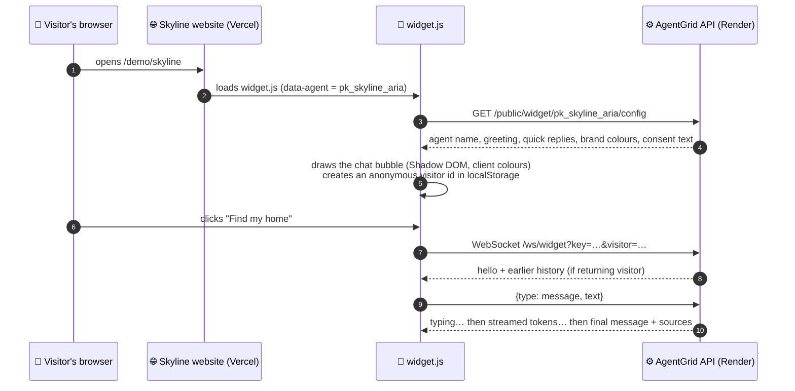

- The **public key** (`pk_skyline_aria`) only identifies which agent to talk to. It grants no admin access.
- Website buttons such as *Find my home* or *Book a visit* call `window.AgentGrid.send("…")`, which opens the chat with that message.
- Everything the visitor says lands in the **Skyline Realty workspace**: inbox, leads, analytics and workflows.

---

## 7. 🔑 Demo accounts and passwords

**Password for every account:** `AgentGrid#Demo2026`. The sign-in page has **one-click buttons** for each.

| Email | Role | Workspace | Sees |
|---|---|---|---|
| `agency@growthpilot.demo` | 🏢 Agency admin | GrowthPilot Digital (+ both clients) | Branded console, client roll-up, new clients, branding, everything inside clients |
| `owner@skyline.demo` | 👔 Client admin | Skyline Realty | Everything for Skyline: agents, inbox, leads, workflows, models, settings |
| `agent@skyline.demo` | 🧑‍💻 Team member | Skyline Realty | Dashboard, inbox, leads, appointments, simulator (no settings or agent edits) |
| `viewer@skyline.demo` | 👀 Viewer | Skyline Realty | Dashboard and read-only agents |
| `owner@brightsmile.demo` | 👔 Client admin | BrightSmile | Everything for BrightSmile |
| `agent@brightsmile.demo` | 🧑‍💻 Team member | BrightSmile | Inbox and handovers |
| `admin@agentgrid.demo` | 🟦 Platform admin | All | Every workspace |

**Role → permissions:**

| Permission | Platform | Agency | Client admin | Team member | Viewer |
|---|:-:|:-:|:-:|:-:|:-:|
| Create clients, white-label branding | ✅ | ✅ | – | – | – |
| AI models, agents, knowledge, channels, workflows | ✅ | ✅ | ✅ | – | – |
| Inbox: claim / reply / resolve | ✅ | ✅ | ✅ | ✅ | – |
| Leads and appointments | ✅ | ✅ | ✅ | ✅ | – |
| Dashboard | ✅ | ✅ | ✅ | ✅ | ✅ |
| Team, API keys, audit log | ✅ | ✅ | ✅ | – | – |

Other defaults you'll meet:

| Item | Default |
|---|---|
| Workflow notification emails | `sales@skyline.demo`, `frontdesk@brightsmile.demo` (fake; change in Settings → Workspace to receive real mail) |
| Agency support email | `help@growthpilot.demo` |
| Timezone | Asia/Kolkata |
| Data retention | 90 days |
| Platform LLM (no key) | Offline demo model |
| Branded sign-in link | `/?brand=growthpilot` |

---

## 8. 🗂️ The console, tab by tab

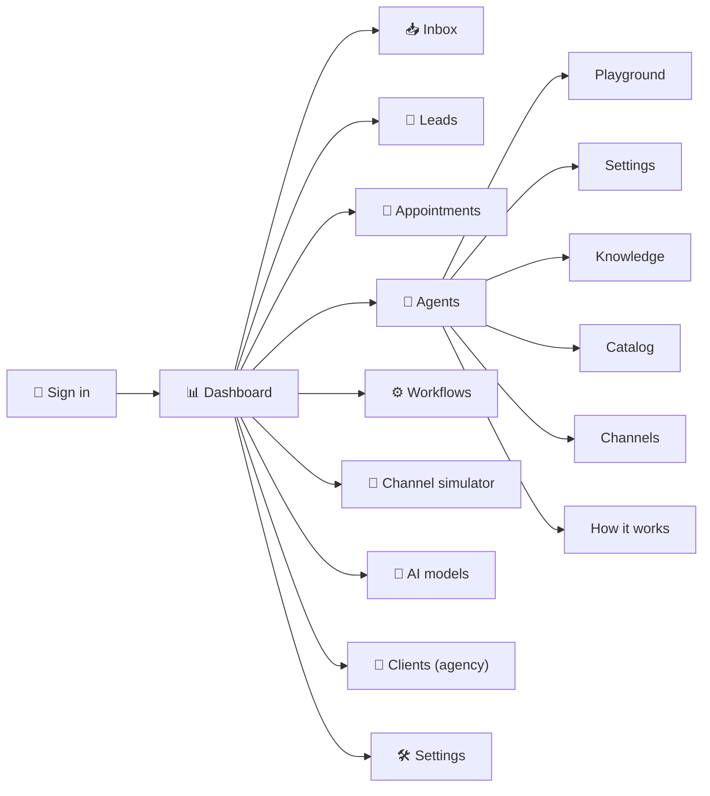

| Tab | What it's for | RFP capability | What to notice |
|---|---|---|---|
| 🔐 **Sign in** | Login with one-click demo accounts; `?brand=growthpilot` shows the agency's branding | Multi-tenant / white-label | Same product, different brand |
| 🧭 **Workspace switcher** (sidebar) | Agencies jump between their clients | Multi-tenant | Each workspace's data is isolated |
| 📊 **Dashboard** | KPIs, conversations per day, lead funnel, channels, per-agent and per-human performance, model usage and cost. Agency view = roll-up + client table | Analytics | "Waiting for a person" pill links to the inbox |
| 📥 **Inbox** | Live list (needs a person first), conversation thread, AI handover summary, lead card, appointments, contact details; Claim / Return to AI / Resolve; **Suggest** = AI-drafted replies | Human handover | Click *Why this reply* under any AI message to see the graph path, tools and cost |
| 🎯 **Leads** | Table or pipeline board, filter by stage, search, change stage, notes, CSV export | Lead qualification | Score bar 0–100; open the conversation from a lead |
| 📅 **Appointments** | Bookings grouped by day; mark completed or cancelled | Workflow automation | Booked by the AI in chat |
| 🤖 **Agents** | Agent cards (conversations, documents, channels); create from a template | Omnichannel | One agent → many channels |
| ↳ **Playground** | Chat with the agent; *Last turn* shows graph path, tool calls, retrieved sources, lead score, latency, tokens, cost | AI quality | Best place to understand the AI |
| ↳ **Settings** | Name, persona, greeting, quick replies, business profile, model and fallback, qualification weights and thresholds, business hours, handover keywords and sensitive topics | Configuration | Change a weight and the scoring changes |
| ↳ **Knowledge** | Upload PDF/DOCX/TXT/MD/CSV, add FAQ text, import a web page; status; **Test retrieval** shows what the agent would read and whether it's confident | RAG | Confident vs not confident |
| ↳ **Catalog** | Items with price and attributes used by `recommend_items` | Recommendations | Attributes like location, type, BHK, tags |
| ↳ **Channels** | Widget snippet + demo site link; connect Telegram (paste token); connect WhatsApp (IDs, token, secret → callback URL + verify token); REST example | Omnichannel | Step-by-step help inside each card |
| ↳ **How it works** | The LangGraph flow, plus the diagram generated from code | Explainability | Five steps, one loop |
| ⚙️ **Workflows** | Visual steps per workflow, editor (trigger, filters, steps), **Run history** (each step's result, retry), **Email outbox** | Workflow automation | Lead alert and booking confirmation runs |
| 📱 **Channel simulator** | Phone-style WhatsApp / Telegram chat without a real phone; same pipeline as real webhooks | Omnichannel | Appears in the inbox like a real WhatsApp chat |
| 🧠 **AI models** | Platform default status + Test; add your own providers (OpenRouter, OpenAI, Anthropic, Qwen, Ollama, custom) with encrypted keys; Test checks tool calling | Bring your own model | Per-agent choice with fallback |
| 🏢 **Clients** (agency only) | Client cards with 30-day stats; **New client** = workspace + agent from a template in one step | Multi-tenant SaaS | Onboarding in under a minute |
| 🛠️ **Settings** | Workspace (timezone, retention, notification email, consent text, blocked words) · Integrations (HubSpot, Slack, webhook secret) · White-label branding with live preview (agency) · Team (invite with roles) · API keys · Failed jobs (retry) · Audit log | Enterprise readiness | Every change is audited |
| 🌐 **Demo websites** | `/demo/skyline`, `/demo/brightsmile` with the live widget | Omnichannel | What a client's customer sees |

---

## 9. 🛣️ The full customer journey (end to end)

A visitor on Skyline's website becomes a qualified, booked lead, gets a confirmation, and is then helped by a human.

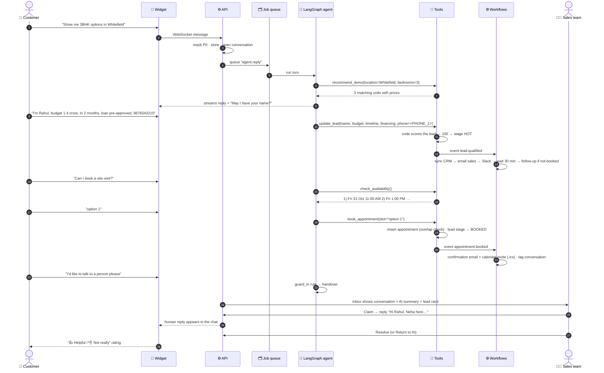

**What happens to the data along the way:**

| Step | Where it's stored | Where you see it |
|---|---|---|
| Messages (masked) | `messages` | Inbox thread |
| Real phone/email | encrypted in `pii_tokens`; real values on the lead/contact for the business | Inbox contact card, Leads |
| Lead + score | `leads` | Leads, Inbox lead card |
| Booking | `appointments` | Appointments |
| Workflow runs | `workflow_runs`, `workflow_step_runs` | Workflows → Run history |
| Emails | `outbox_emails` (+ SMTP if configured) | Workflows → Email outbox |
| Analytics events, cost | `analytics_events`, `usage_daily` | Dashboard |

---

## 10. 🤖 The AI agent: how one reply is produced

Every reply runs through this **LangGraph** graph (`backend/app/agent/graph.py`):

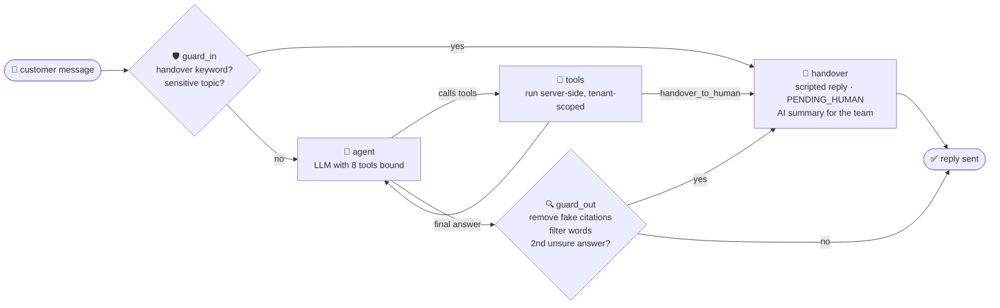

| Node | What it does | Why |
|---|---|---|
| **guard_in** | Checks the message against the agent's handover keywords and sensitive topics | Some things must never depend on the AI's judgment |
| **agent** | The LLM gets a system prompt (persona, rules, business profile, current context: time, known lead fields, what's still missing, offered slots) plus history, and decides to answer or call tools | Language understanding |
| **tools** | Executes tool calls. Tenant, agent and conversation ids come from the **server**, never from the model | The model cannot reach another business's data |
| **guard_out** | Removes `[S#]` citations that weren't actually retrieved, masks blocked words, counts consecutive "not sure" answers | Prevents fake sources and loops of unhelpful answers |
| **handover** | Writes a polite, business-hours-aware handover message | Smooth escalation |

**The 8 tools:**

| Tool | Does | Changes data? |
|---|---|---|
| `search_knowledge` | Hybrid search over the agent's documents; returns `[S1]…[S5]` or `NO_RELEVANT_RESULTS` | No |
| `update_lead` | Saves fields the customer shared → code scores and stages the lead → events | ✅ lead, contact |
| `recommend_items` | Ranks catalog items by fit (area, budget, type, BHK, keywords) | No |
| `check_availability` | Free slots from business hours minus existing bookings | No (remembers offered slots) |
| `book_appointment` | Books the chosen slot; blocks overlaps | ✅ appointment, lead stage |
| `reschedule_appointment` / `cancel_appointment` | Changes the customer's upcoming booking | ✅ |
| `handover_to_human` | Asks for a person | ✅ conversation state |

**What the LLM sees:** masked placeholders like `<PHONE_1>`, never the real number. When it calls `update_lead(phone="<PHONE_1>")`, the tool swaps in the real value on the server.

**Models:** each agent uses a *main* model (conversation + tools), a *cheap* model (handover summary, suggested replies) and an optional *fallback* model. Any provider works through LangChain. With no key, the **offline demo model** (rule-based, but calling the same tools) answers, so the demo always works.

---

## 11. 💬 Every conversation flow, explained

### 11.1 Question answered from documents (RAG)

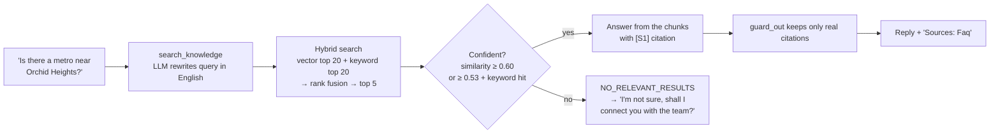

*Example:* "Is there a metro near Orchid Heights?" → "Kadugodi Tree Park metro station on the Purple Line is 1.2 km away… · Sources: Faq".
*Why hybrid:* vectors catch meaning ("kitna price hai"), keywords catch exact terms ("RERA", "Lakeview").

### 11.2 Question the documents can't answer (no hallucination)

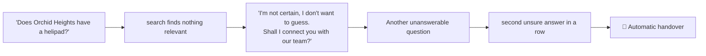

### 11.3 Lead qualification and scoring

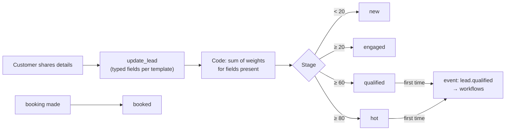

Real-estate weights (editable in Agents → Settings):

| Field | Points | Rule |
|---|---|---|
| Intent (buy/rent/invest) | 10 | |
| Location | 15 | |
| Budget | 20 | |
| Property type | 10 | |
| Bedrooms | 5 | |
| Timeline | up to 15 | ≤ 3 months: 15 · ≤ 6: 10 · later: 4 |
| Financing | up to 10 | pre-approved or cash: 10 · loan: 6 |
| Name | 7 | |
| Phone | 8 | |

*Examples:* buy + Whitefield + 1.4 Cr + apartment + 3 BHK + 2 months + phone = 10+15+20+10+5+15+8 = **83 → hot**. Add name and "loan pre-approved" → **100**. Only area + budget = 35 → **engaged**.

### 11.4 Product recommendation

`recommend_items` scores every catalog item: area match +3, within budget +3 (slightly over +1, far over −2), type +2, BHK +2, keyword/tag matches +1 each. It returns the top 3 with reasons, e.g. *"Greens Villa, Phase 1: ₹3.40 Cr | Sarjapur Road… (in Sarjapur Road; matches schools, villa)"*.

### 11.5 Booking

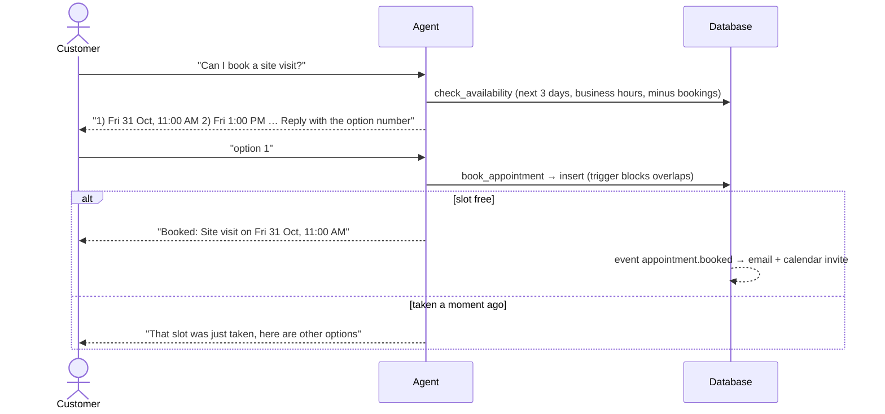

### 11.6 Handover to a human: the four triggers

| Trigger | Example | Decided by |
|---|---|---|
| Customer asks | "talk to a person please", "human", "connect me to an agent" | Code (guard_in) |
| Sensitive topic | "severe pain and swelling", "lawsuit" | Code (guard_in) |
| AI decides | customer frustrated, complex request | LLM (`handover_to_human` tool) |
| Unsure twice in a row | two unanswerable questions | Code (guard_out) |
| Something failed | every model errored | Code (scripted apology + handover) |

### 11.7 Conversation states

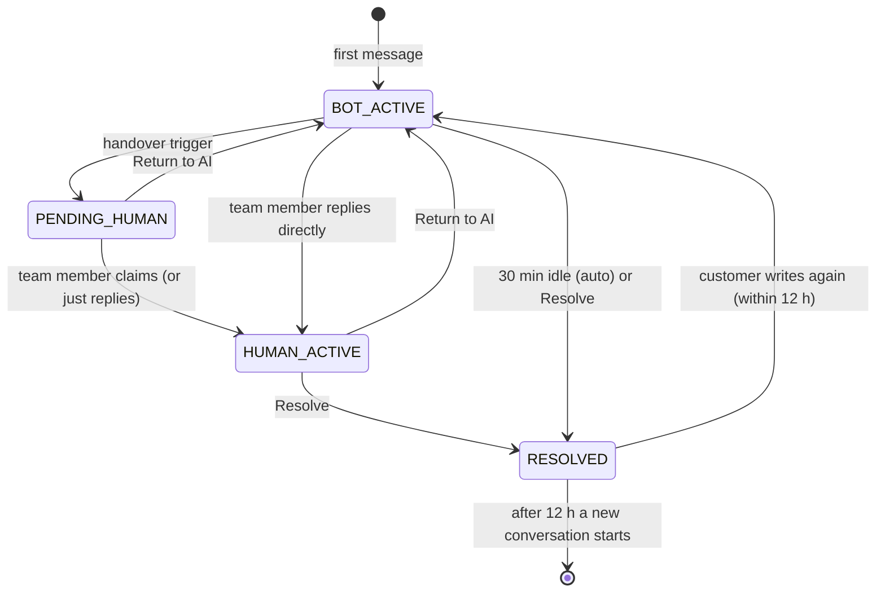

> [!NOTE]
> Only **BOT_ACTIVE** conversations run the AI. While a human owns the chat, the AI stays silent and new customer messages go straight to the inbox.

### 11.8 Human takeover in the inbox

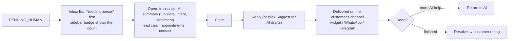

### 11.9 WhatsApp and Telegram

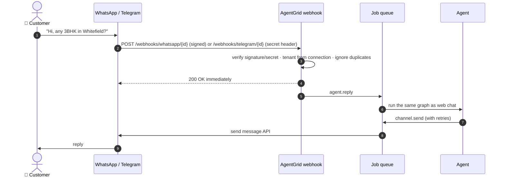

- **Telegram:** paste the BotFather token; AgentGrid registers the webhook itself. Locally (no HTTPS) it polls instead.
- **WhatsApp:** Meta's free test number. Paste the phone number ID, token and app secret; copy the callback URL and verify token into Meta.
- **Simulator:** runs the same pipeline minus the network hop, so anyone can try both channels. Details: [integration.md](integration.md).

### 11.10 REST API channel

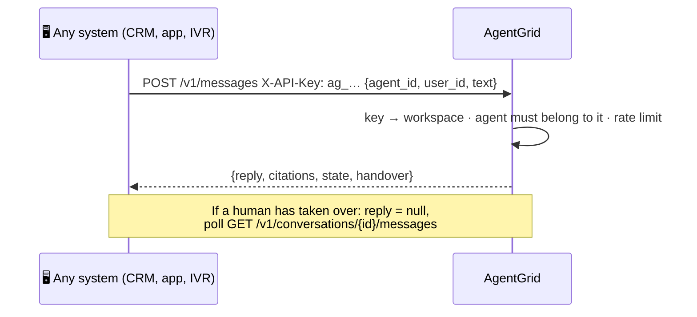

---

## 12. 🧩 Platform flows

### 12.1 Workflows (business automation)

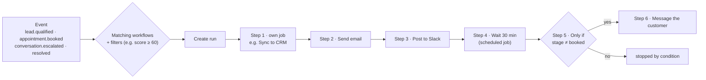

- Each step is a **durable job**: retried with backoff, error visible in Run history, **Retry** button.
- Step text uses templates such as `{{ lead.fields.name }}`, `{{ appointment.when }}`, rendered in a sandbox.
- Actions: Sync to CRM · Push to HubSpot · Send email (+ `.ics`) · Post to Slack · Call webhook (signed) · Message the customer · Tag conversation · Wait · Only if.

### 12.2 Multi-tenant isolation (row-level security)

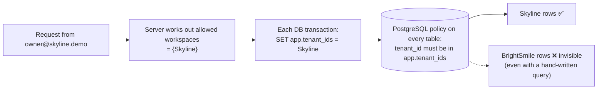

An **agency admin's** allowed set = the agency + all its clients. Tests prove a Skyline user gets 404 for a BrightSmile conversation and 403 for a forged workspace header.

### 12.3 White-label branding

```mermaid
flowchart LR
  PL["Platform default<br/>AgentGrid · navy + gold"] --> AGB["Agency branding<br/>'GrowthPilot AI' · teal + amber"] --> CLB["Client branding<br/>Skyline: widget colours, title"]
  CLB --> R["Resolved brand<br/>(nearest setting wins)"]
  R --> CONSOLE["Console: name, colours, 'Powered by AgentGrid'"]
  R --> WIDG["Widget on the client's website"]
```

### 12.4 Personal data protection

```mermaid
flowchart LR
  IN["'Call me on 9876543210'"] --> DET["Detect: phone, email, card (Luhn),<br/>Aadhaar (Verhoeff), PAN"]
  DET --> TOK["Store: 'Call me on &lt;PHONE_1&gt;'<br/>real value encrypted per tenant"]
  TOK --> LLM["LLM only ever sees &lt;PHONE_1&gt;"]
  LLM --> TOOL["update_lead(phone='&lt;PHONE_1&gt;')<br/>→ server swaps in the real number"]
  TOK --> OUT["Outgoing reply: unmasked only<br/>for this same conversation"]
```

### 12.5 Onboarding a new client (agency)

```mermaid
flowchart LR
  A[Clients → New client] --> B[Name + template + agent name + email]
  B --> C["Workspace created<br/>agent + template workflows"]
  C --> D["Knowledge: upload docs"]
  D --> E["Channels: widget snippet / Telegram / WhatsApp"]
  E --> F[Live in minutes]
```

---

## 13. 🗄️ Data model

```mermaid
erDiagram
  TENANTS ||--o{ TENANTS : "agency has clients"
  TENANTS ||--o{ MEMBERSHIPS : has
  USERS ||--o{ MEMBERSHIPS : has
  TENANTS ||--o{ AGENTS : owns
  TENANTS ||--o{ LLM_PROVIDERS : owns
  AGENTS ||--o{ CHANNEL_CONNECTIONS : "WhatsApp / Telegram"
  AGENTS ||--o{ KNOWLEDGE_SOURCES : has
  KNOWLEDGE_SOURCES ||--o{ KNOWLEDGE_CHUNKS : "split into (vector + text)"
  AGENTS ||--o{ CATALOG_ITEMS : has
  CONTACTS ||--o{ CONVERSATIONS : has
  AGENTS ||--o{ CONVERSATIONS : handles
  CONVERSATIONS ||--o{ MESSAGES : contains
  CONVERSATIONS ||--o{ PII_TOKENS : "masked values"
  CONVERSATIONS ||--o| LEADS : produces
  CONVERSATIONS ||--o{ APPOINTMENTS : books
  TENANTS ||--o{ WORKFLOWS : defines
  WORKFLOWS ||--o{ WORKFLOW_RUNS : runs
  WORKFLOW_RUNS ||--o{ WORKFLOW_STEP_RUNS : steps
```

Plus: `jobs` (queue), `analytics_events`, `usage_daily` (tokens/cost), `outbox_emails`, `audit_logs`, `api_keys`, `refresh_tokens`. Every business table has `tenant_id` and a row-level security policy. Schema: [`backend/migrations/001_init.sql`](backend/migrations/001_init.sql).

---

## 14. 📊 Analytics: what each number means

| KPI | Definition |
|---|---|
| Conversations | Conversations started in the period |
| Automated resolution | Resolved conversations with **no human reply** ÷ resolved conversations |
| Escalation rate | Conversations handed to a person ÷ conversations |
| First response (median / p95) | Time from the customer's first message to the first reply |
| Qualified leads | Leads at stage qualified, hot or booked |
| Lead conversion | Qualified ÷ captured (any stage above *new*) |
| Booking rate | Booked ÷ qualified |
| Customer rating | Average of widget ratings (👍 = 5, 👎 = 1) |
| LLM cost | Sum of per-message token cost (priced per model) |

The **agency dashboard** sums all clients and lists each client's conversations, escalations, qualified leads, bookings and cost.

---

## 15. 🔐 Security in one table

| Risk | Control |
|---|---|
| One client seeing another's data | Postgres row-level security + app filters + tests |
| AI leaking personal data | Masking before storage and before the LLM; per-tenant encryption |
| Stolen keys | LLM/channel/integration secrets encrypted per workspace, never returned to the browser |
| Fake webhooks | WhatsApp HMAC signature, Telegram secret header, duplicate filter |
| Prompt injection | Tenant ids from server context only; documents and messages treated as data; citation check; eval cases |
| Abuse / cost | Rate limits per visitor, IP and workspace; scoped, hashed API keys |
| Who did what | Audit log (logins, config, keys, knowledge, handovers, exports, erasures) |
| Privacy rights | Export and erase a contact; consent captured; retention purge |

Full detail: [docs/SECURITY.md](docs/SECURITY.md).

---

## 16. 📈 From PoC to scale

```mermaid
flowchart LR
  subgraph PoC["🧪 PoC (built)"]
    P1[Postgres job queue]
    P2[In-process WebSocket rooms]
    P3[In-memory rate limits]
    P4[Workflow steps as jobs]
    P5[Maintenance job]
    P6[One container]
  end
  subgraph Target["🚀 Target (designed)"]
    T1[Kafka / MSK]
    T2[Redis pub/sub]
    T3[Redis counters]
    T4[Temporal]
    T5[Airflow]
    T6[EKS / ECS autoscaling]
  end
  P1 -->|jobs.enqueue| T1
  P2 -->|realtime.publish| T2
  P3 -->|security.rate_limited| T3
  P4 -->|workflows engine| T4
  P5 -->|DAG tasks| T5
  P6 -->|same image, role flag| T6
```

Each arrow is **one module** in the code. Callers don't change. When to switch, and the throughput maths (~4 replies/second per process with 8 concurrent jobs): [docs/SCALING.md](docs/SCALING.md).

---

## 17. 🧪 How to test everything yourself

### 17.1 Run it

| Where | How |
|---|---|
| **Live** | Open the Vercel console URL (and the Render API once so it's awake) |
| **Local** | `cd backend` → `uv sync` → `uv run python -m tools.devdb` → `uv run uvicorn app.main:app --reload --env-file .env`, then `cd console` → `npm install` → `npm run dev` → http://localhost:5173 |

> [!IMPORTANT]
> Without an LLM key the **offline demo model** answers. Every flow below works, but wording is simpler and it struggles with paraphrased questions. Add a key (Console → AI models, or `LLM_API_KEY`) for real AI replies.

### 17.2 Guided test plan (about 30 minutes)

Tick each row. Exact messages to type are in *italics*.

| # | Test | Steps | ✅ Expected |
|---|---|---|---|
| 1 | **Login + roles** | Sign in with each demo button | Agency sees *Clients* and branding; team member has no Settings or Workflows; viewer sees only dashboards |
| 2 | **White-label** | Sign in as `owner@skyline.demo` | Logo says **GrowthPilot AI**, "Powered by AgentGrid" in the sidebar. Open `/?brand=growthpilot` while signed out: branded sign-in |
| 3 | **Dashboard** | Dashboard → change range 7/30/90 days | KPIs and charts update; "waiting for a person" pill |
| 4 | **Agency roll-up** | As agency → Dashboard → *Open* a client | Client table; switching workspace changes all pages |
| 5 | **RAG answer** | `/demo/skyline` → chat: *Is there a metro near Orchid Heights?* | Mentions 1.2 km / Kadugodi, "Sources: …" line |
| 6 | **No hallucination** | Chat: *Does Orchid Heights have a helipad?* then *Do you have projects in Dubai?* | First: "not certain…"; second: handover message |
| 7 | **Recommendation** | New visitor (private window): *Can you recommend a villa near schools on Sarjapur Road?* | Greens Villa options with prices |
| 8 | **Qualification** | *I'm Rahul, want to buy a 3 BHK apartment in Whitefield, budget 1.4 crore, in 2 months, home loan pre-approved, 9876543210* | Console → Leads: Rahul, score **100**, stage **hot**; Inbox transcript shows `9876543210` to staff, but the stored message is masked (playground trace shows `<PHONE_1>`) |
| 9 | **Workflows** | After #8 → Workflows → Run history / Email outbox | "Hot lead to CRM + sales alert" run: CRM synced, email to sales, Slack *skipped* (until connected), then waiting 30 min |
| 10 | **Booking** | Chat: *Can I book a site visit?* → *option 1* | "Booked: Site visit on …"; Appointments shows it; Email outbox has "Site visit confirmed" with **Calendar invite** badge; lead stage **booked** |
| 11 | **No double-booking** | Another visitor books the same slot from the same list | "That slot was just taken…" |
| 12 | **Handover + inbox** | Chat: *I want to talk to a person please* → sign in as `agent@skyline.demo` → Inbox | Conversation on top with **AI summary**, lead card; sidebar badge |
| 13 | **Human reply** | Claim → *Suggest* → pick or type a reply → Send | Reply appears instantly in the website chat, labelled Team |
| 14 | **Return to AI / Resolve** | Click *Return to AI*, chat again; then *Resolve* | AI answers again; after resolve the widget asks for a rating |
| 15 | **Sensitive topic (clinic)** | `/demo/brightsmile`: *I have severe pain and swelling since last night* | Immediate handover; "Escalation alert" email in BrightSmile's outbox |
| 16 | **Clinic booking** | *I'd like to book a check-up* → *option 2* | Appointment + confirmation email; reminder step scheduled 24 h before |
| 17 | **Simulator** | Channel simulator → WhatsApp → *How much is a root canal?* (BrightSmile) or Skyline questions | Replies in the phone UI; conversation in Inbox with WhatsApp icon |
| 18 | **Playground trace** | Agents → Aria → Playground → any message → *Last turn* | Path `guard_in → agent → tools → agent → guard_out`, tool args, sources, latency, cost |
| 19 | **Knowledge** | Agents → Aria → Knowledge → add FAQ "Pets": *Q: Are pets allowed? A: Yes, with a pet park.* → Test retrieval *pets* | Status ready; confident result; ask the agent and it answers with the source |
| 20 | **Settings change** | Agents → Aria → Settings → set *Budget* weight to 40 → Save → qualify again | Score changes, proving scoring is deterministic and configurable |
| 21 | **BYO model** (needs a key) | AI models → Add provider → Test → assign to Aria | Test shows "tool calling OK"; Playground *Model* shows it |
| 22 | **New client** | As agency → Clients → New client (template: Healthcare clinic) | Workspace with agent and 2 workflows; switches to it |
| 23 | **Team + roles** | Settings → Team → invite as Viewer → sign in with the temporary password | Viewer sees dashboards only |
| 24 | **API channel** | Settings → API keys → Create → run the curl shown with *What are the payment plans?* | JSON with `reply` and `citations` |
| 25 | **Isolation** | Signed in as Skyline, open a BrightSmile conversation URL | 404 / not found |
| 26 | **GDPR** | Inbox → contact card → Export data / Erase | JSON download; erased contact disappears |
| 27 | **Audit** | Settings → Audit log | Your logins, changes, exports listed |
| 28 | **Real channels** (optional) | Follow [integration.md](integration.md) for Telegram / WhatsApp | Same behaviour as the simulator on a real phone |

### 17.3 Automated checks

```bash
cd backend
uv run pytest                     # 22 tests: isolation, PII masking, scoring, signatures, jobs, full agent flows, booking conflicts, API
uv run python -m evals.run_evals  # 28 AI scenarios → docs/EVAL_REPORT.md
uv run python -m evals.run_evals --models openrouter:anthropic/claude-sonnet-4.5,openrouter:openai/gpt-4o-mini   # compare models (needs a key)
uv run python -m tools.probe_rag  # retrieval confidence calibration
cd ../console && npm run build    # type-check + production build
```

| Eval suite | What it proves |
|---|---|
| grounded | Answers come from documents, with valid citations |
| hallucination | Unanswerable questions → admits it or hands over |
| lead | Correct field extraction and stage |
| recommendation | Right catalog items |
| booking | Real appointment row, correct tool sequence |
| handover | Escalates when it should, and only then |
| safety | Injection resisted, no raw personal data stored |

### 17.4 Reset the demo

```bash
cd backend && uv run python -m app.seed --reset   # wipes and recreates all demo data (local or with the Render DATABASE_URL)
```

---

## 18. 🗺️ Code map: where each thing lives

```
Cusomer Agent RFA/
├── README.md · Plan.md · integration.md · Project_Explanation.md   ← docs you're reading
├── render.yaml                       ← Render blueprint (API + Postgres)
├── docs/                             ← ARCHITECTURE · SCALING · SECURITY · DEMO_SCRIPT · EVAL_REPORT
├── backend/                          ← FastAPI (deployed on Render)
│   ├── migrations/001_init.sql       ← schema + row-level security + no-overlap trigger
│   ├── app/
│   │   ├── main.py                   ← app, startup (migrate, seed, job runner), metrics
│   │   ├── db.py · auth.py · security.py   ← tenant transactions, RBAC, crypto, PII, rate limits
│   │   ├── conversations.py          ← ★ the pipeline: inbound → agent turn → deliver → handover
│   │   ├── agent/graph.py            ← ★ LangGraph graph
│   │   ├── agent/tools.py            ← ★ the 8 tools
│   │   ├── agent/prompts.py · guardrails.py · scoring.py · copilot.py
│   │   ├── llm.py                    ← any-provider model factory + offline demo model
│   │   ├── rag.py                    ← ingest + hybrid search
│   │   ├── workflows.py · integrations.py   ← engine + email/Slack/HubSpot/webhooks
│   │   ├── channels.py               ← WhatsApp + Telegram adapters
│   │   ├── jobs.py · realtime.py     ← Postgres queue, WebSocket rooms
│   │   ├── analytics.py · templates/ · seed.py · seed_data/
│   │   └── api/                      ← auth, admin, agents, inbox, workflows, analytics, public (widget, webhooks, /v1)
│   ├── static/widget.js              ← embeddable chat widget
│   ├── tests/ · evals/ · tools/
│   └── Dockerfile
└── console/                          ← React app (deployed on Vercel)
    └── src/
        ├── session.tsx · api.ts · realtime.ts · ui.tsx · Layout.tsx
        └── pages/  Login · Dashboard · Inbox · Leads · Appointments · Agents · AgentDetail
                    Workflows · Simulator · Models · Clients · Settings · DemoSite
```

---

## 19. ⚠️ Honest limitations

| Limitation | Why / plan |
|---|---|
| Offline demo model is rule-based | Only used without a key; real LLMs handle paraphrases and Hinglish properly |
| One API process (single worker) | Simple and enough for a pilot; Redis + Kafka are the scale-out path |
| WhatsApp test number: 5 recipients, 24 h token | Meta's test limits; a system-user token fixes the expiry; production needs business verification |
| WhatsApp messages that start from the business (templates) | Roadmap; customer-initiated chats work |
| Tokens kept in browser storage | Console and API are on different domains; production uses one domain + httpOnly cookies |
| No billing, SSO, voice, SMS, Instagram | Roadmap (Phase 2/3 in the pre-read) |
| Free Render plan sleeps | Use Starter for demos |

---

<p align="center"><b>AgentGrid</b> · PoC for TTG-AI-AGENTGRID · Built with FastAPI, LangGraph, PostgreSQL + pgvector, React</p>
