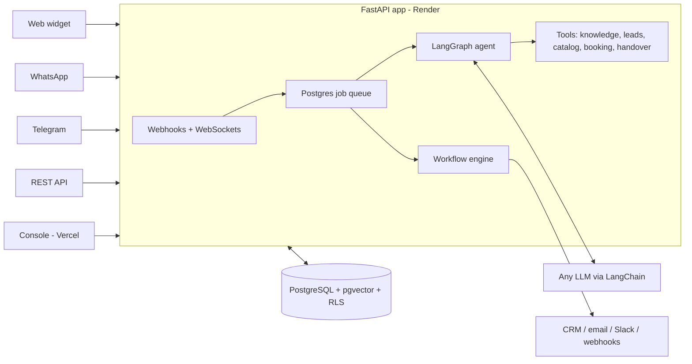

# AgentGrid

**Multi-tenant AI agents for customer conversations, lead qualification and business automation.**
A working PoC for RFP **TTG-AI-AGENTGRID** (The Talent Grid).

Businesses and agencies deploy AI agents on **web chat, WhatsApp, Telegram and a REST API**. The agents answer from the business's own documents (with sources), qualify and score leads, recommend products, book appointments, trigger CRM and email workflows, and hand over to a human with a summary. Agencies white-label the whole platform and run many client workspaces from one console.

| | |
|---|---|
| **Console** | `https://<your-app>.vercel.app` (see [Deploy](#deploy)) |
| **API + docs** | `https://<your-api>.onrender.com/docs` |
| **Demo websites** | `/demo/skyline` (real estate) · `/demo/brightsmile` (dental clinic) on the console URL |
| **Demo password** | `AgentGrid#Demo2026` for every demo account (one-click buttons on the sign-in page) |

---

## What to try (5 minutes)

1. **Open a demo website** (`/demo/skyline`) and click *Find my home*. Ask about prices, give a budget, book a site visit, then type *"talk to a person"*.
2. **Sign in as the Skyline team member** (`agent@skyline.demo`). Your conversation is in the **Inbox** with an AI handover summary and a lead score. Claim it and reply; the reply appears in the website chat.
3. **Sign in as the agency** (`agency@growthpilot.demo`). The console is white-labeled as **GrowthPilot AI**. The dashboard rolls up both client workspaces; open either one.
4. **Agents → Aria → Playground**: every reply shows the LangGraph path, tool calls, retrieved sources, lead score, latency and cost.
5. **Channel simulator**: chat as a WhatsApp or Telegram user without a phone. Messages run through the same pipeline as real webhooks.
6. **Workflows → Run history / Email outbox**: qualified-lead alerts and booking confirmations with calendar invites.

| Demo account | Role | What you see |
|---|---|---|
| `agency@growthpilot.demo` | Agency admin | White-labeled console, client roll-up, branding, new clients |
| `owner@skyline.demo` | Client admin | Real-estate agent "Aria": everything in one workspace |
| `agent@skyline.demo` | Team member | Inbox and handovers only |
| `owner@brightsmile.demo` | Client admin | Clinic agent "Mia" |
| `admin@agentgrid.demo` | Platform admin | All workspaces |

## Capabilities (RFP → where it is)

| RFP capability | Implementation |
|---|---|
| Omnichannel agents | Web widget (one `<script>` tag, streaming, white-labeled), **WhatsApp Cloud API**, **Telegram bot** (webhook, or polling in local dev), **REST API** (`POST /v1/messages`), channel simulator |
| Lead qualification | Typed `update_lead` tool per industry template; **deterministic** scoring and stages (new → engaged → qualified → hot → booked); leads table and pipeline, CSV export |
| Workflow automation | Event-triggered workflows (filters, delays, conditions, retries): built-in CRM, HubSpot, email with `.ics` invite, Slack, signed webhooks, proactive messages; conflict-safe booking |
| AI knowledge assistant | Upload PDF/DOCX/TXT/MD/CSV/URL → LangChain splitter → local embeddings → **hybrid search** (pgvector + full-text, RRF). Answers cite sources; citations are validated; unsure answers are admitted, not invented |
| Human handover | Keyword, sensitive-topic, repeated-low-confidence and tool triggers → live inbox with summary, lead card, suggested replies, claim / return to AI / resolve |
| Multi-tenant SaaS | Platform → agency → client hierarchy, **Postgres row-level security**, RBAC (5 roles), white-label branding, industry templates, API keys, audit log, usage metering |
| Analytics | Conversations, automated resolution, escalation, first-response p50/p95, funnel, appointments, CSAT, LLM tokens and cost by model, per agent and per human agent, agency roll-up |

**Bring your own model.** Each workspace and agent can use OpenAI, Anthropic, **Qwen**, OpenRouter, a private Ollama/vLLM server, or any OpenAI-compatible endpoint, with an automatic fallback model. With no key at all, agents run on a built-in **offline demo model** that still drives the real tools, knowledge and workflows, so the demo never breaks.

## Architecture



The agent is a LangGraph graph: **input guard** (mask personal data, handover rules) → **LLM ⇄ tools** → **output guard** (validate citations, filter, count unsure answers) → **handover** when needed. Deterministic code owns state, scores and bookings; the LLM handles language and tool choice.

The PoC deliberately runs on **FastAPI + PostgreSQL only**. Kafka, Redis, Temporal and Airflow are in the target architecture, and the code has a single seam for each one. See [docs/SCALING.md](docs/SCALING.md).

More: [Project_Explanation.md](Project_Explanation.md) (visual walkthrough + test plan) · [integration.md](integration.md) (step-by-step: LLM keys, Telegram, WhatsApp, Slack, SMTP, HubSpot) · [docs/ARCHITECTURE.md](docs/ARCHITECTURE.md) · [docs/SECURITY.md](docs/SECURITY.md) · [docs/DEMO_SCRIPT.md](docs/DEMO_SCRIPT.md) · [docs/EVAL_REPORT.md](docs/EVAL_REPORT.md) · [Plan.md](Plan.md)

## Run locally (Windows, macOS or Linux; no Docker needed)

```bash
cd backend
uv sync
uv run python -m tools.devdb          # embedded Postgres 16 + pgvector, writes backend/.env
uv run uvicorn app.main:app --reload --env-file .env   # migrates and seeds demo data on first start
```

```bash
cd console
npm install
npm run dev                            # http://localhost:5173 (VITE_API_URL defaults to http://localhost:8000)
```

Optional: put an LLM key in `backend/.env` (`LLM_PROVIDER=openrouter`, `LLM_API_KEY=...`). Without one, the offline demo model runs.

Checks:

```bash
cd backend && uv run ruff check . && uv run pytest        # 22 tests: RLS isolation, PII masking, booking conflicts, full agent flows
cd backend && uv run python -m evals.run_evals            # AI quality report → docs/EVAL_REPORT.md
cd console && npm run build
```

## Deploy

**Backend on Render** (Blueprint):
1. Push this repo to GitHub.
2. Render → **New → Blueprint** → select the repo. `render.yaml` creates the API (Docker) and a PostgreSQL 16 database.
3. Set `CONSOLE_URL` (your Vercel URL) and, when you have one, `LLM_API_KEY`. `JWT_SECRET` and `MASTER_KEY` are generated. Demo data seeds itself on first start.
4. Use the **Starter** plan for demos. The free plan sleeps after 15 minutes idle.

**Console on Vercel**:
1. Vercel → **Add New → Project** → import the repo, set **Root Directory** to `console` (framework: Vite).
2. Add env var `VITE_API_URL=https://<your-api>.onrender.com` and deploy.

**Channels** (optional, no verification wait):
- **Telegram**: create a bot with @BotFather, then Agents → Channels → paste the token. The webhook is registered automatically.
- **WhatsApp**: Meta for Developers → app → WhatsApp → API Setup (free test number, add your phone as a recipient). Paste the phone number ID, access token and app secret in Agents → Channels, then copy the callback URL and verify token into Meta's Configuration page. The temporary token lasts 24 hours.

## Honest status

| Item | Status |
|---|---|
| Web chat, REST API, Telegram, WhatsApp test number, RAG, lead scoring, recommendations, booking, workflows, handover, RBAC, RLS, white-label, analytics, BYO model, evals | Built and tested |
| HubSpot, Slack, SMTP | Built; active when you add a token or URL. Emails always land in the Outbox |
| Kafka, Redis, Temporal, Airflow, Kubernetes, multi-AZ | Designed ([SCALING.md](docs/SCALING.md)); the PoC runs one process on Postgres |
| WhatsApp production number, Messenger, SMS, voice, SSO, billing | Roadmap |

All demo businesses, people and data are fictional.
