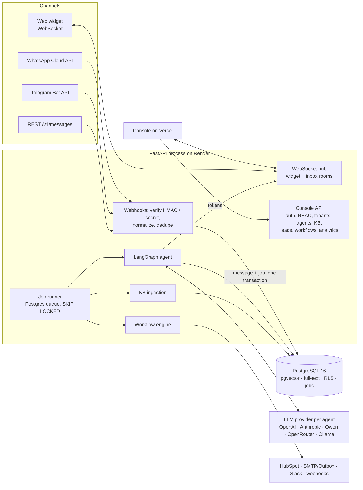
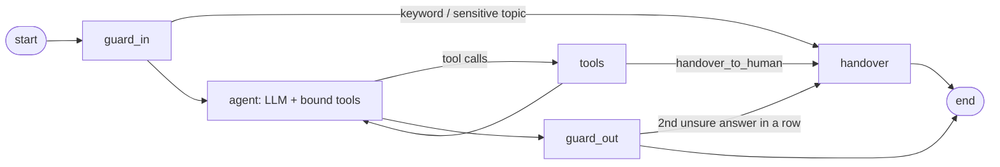

# AgentGrid architecture (PoC as built)

## Components

## Message flow

1. **Inbound.** The channel adapter verifies the request (Meta `X-Hub-Signature-256`, Telegram secret token, API key, or widget key + visitor id), resolves the tenant from the connection, and calls `conversations.inbound()`.
2. **One transaction:** upsert contact → open or reopen conversation → **mask personal data** (`<PHONE_1>`, `<EMAIL_1>`; originals encrypted in `pii_tokens`) → insert message (a unique `(tenant, external_id)` index drops webhook retries) → enqueue `agent.reply`. The webhook returns 200 immediately.
3. **Job runner** claims the job (`FOR UPDATE SKIP LOCKED`), takes a per-conversation lock (ordered replies), and runs the turn.
4. **LangGraph turn** (`app/agent/graph.py`):

5. **Tools** read tenant, agent and conversation ids from the server-side `Turn` in `RunnableConfig`, never from model arguments. The model cannot reach another tenant. Tools: `search_knowledge`, `update_lead`, `recommend_items`, `check_availability`, `book_appointment`, `reschedule_appointment`, `cancel_appointment`, `handover_to_human`.
6. **Output guard** removes citations to sources that weren't retrieved, filters blocked terms, and tracks consecutive low-confidence answers.
7. **Persist and deliver:** the reply is stored masked with tokens, cost and trace; it is unmasked only for delivery. Web chat streams tokens over the WebSocket; WhatsApp and Telegram replies go out through a `channel.send` job with retries.
8. **Events** (`lead.qualified`, `appointment.booked`, `conversation.escalated`, …) are written to `analytics_events` and start matching workflows. Each step is its own job with retries; delays are jobs scheduled for later.

## Data model

All tenant tables carry `tenant_id` and a row-level security policy, `FORCE`d so it applies to the table owner too. Key tables: `tenants` (platform/agency/client hierarchy, branding, encrypted integration secrets), `users`, `memberships`, `agents` (template config + model choice), `llm_providers` (encrypted keys), `channel_connections`, `contacts`, `conversations` (state machine, summary, memory), `messages` (masked content, citations, trace, tokens, cost, latency), `pii_tokens`, `leads`, `appointments` (overlap blocked by a locking trigger), `catalog_items`, `knowledge_sources`, `knowledge_chunks` (`vector(384)` HNSW + generated `tsvector` GIN), `workflows`, `workflow_runs`, `workflow_step_runs`, `jobs`, `analytics_events`, `usage_daily`, `outbox_emails`, `audit_logs`. Schema: `backend/migrations/001_init.sql`.

## Retrieval

- Load (pypdf, python-docx, text/HTML) → `RecursiveCharacterTextSplitter` (650 chars, 100 overlap, heading-aware) → FastEmbed `bge-small-en-v1.5` (local, 384-d). Any OpenAI-compatible embedding API also works, or none at all (keyword search only).
- Search: top 20 by cosine + top 20 by `ts_rank` (OR query) → reciprocal rank fusion → top 5, scoped to the agent.
- Confidence: calibrated with `tools/probe_rag.py` (on-topic ≈ 0.60–0.87 similarity, off-topic ≈ 0.50–0.59). Below the bar the tool returns `NO_RELEVANT_RESULTS` and the agent says it is unsure; two in a row hand over.
- The LLM writes the search query, so Hindi/Hinglish questions are searched in English.

## Models

`app/llm.py` builds every model with LangChain `init_chat_model`: Anthropic natively; OpenAI, OpenRouter, Qwen (DashScope), Ollama and any OpenAI-compatible URL through the OpenAI client. Each agent has a main model (tools + streaming), a cheap model (handover summaries, suggested replies through structured output) and an optional fallback (`with_fallbacks`). Token usage is normalised by LangChain and priced per model. With no key, `OfflineModel` (a rule-based `BaseChatModel` that calls the same tools) keeps every flow working.

## Decisions

| Decision | Alternative | Why |
|---|---|---|
| LangGraph + LangChain | Hand-written loop | Provider-agnostic tool calling; the deterministic/LLM split is an explicit graph that can be drawn and tested |
| Postgres job queue | Kafka | One service to run; durable, transactional with the data. Kafka is the scaling target (seam: `jobs.enqueue`) |
| No Redis | Redis | A single process holds sockets, locks and rate limits. Redis is the target for multiple replicas (seams: `realtime.publish`, `security.rate_limited`) |
| Own workflow engine | Temporal / Airflow | Small, visible, retryable steps. Temporal (durable workflows) and Airflow (batch) are documented targets |
| Own hybrid SQL | `langchain-postgres` PGVector | Needs our schema, RLS and keyword + vector fusion |
| Stateless graph, history from `messages` | LangGraph checkpointer | One source of truth that includes human-agent replies |
| asyncpg + SQL migrations | ORM + Alembic | Few moving parts; RLS behaviour is explicit |
| Trigger for double-booking | `EXCLUDE` constraint | `EXCLUDE` needs `btree_gist`, which isn't available everywhere; the trigger takes a per-agent lock and raises the same error code |
