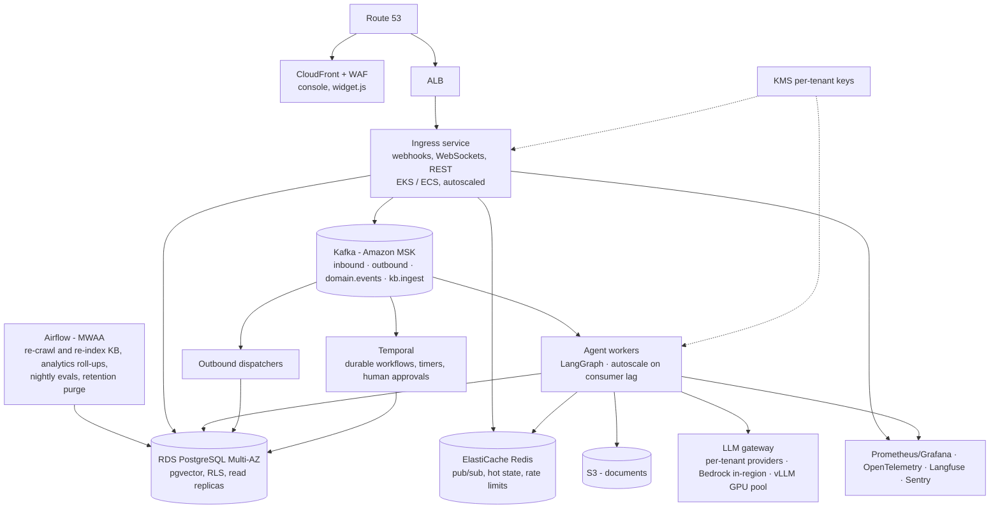

# Scaling AgentGrid: from PoC to production

The PoC runs as **one FastAPI process plus PostgreSQL**. That is a deliberate choice: it deploys in minutes, has few failure points, and is enough for demos and pilots. Every heavy component the RFP lists (Kafka, Redis) and that a production platform needs (Temporal, Airflow, Kubernetes) has **one seam in the code**, so it can be swapped in without touching callers.

## Target architecture (AWS)

## Seams: what changes, what doesn't

| Concern | PoC | Target | Seam (callers unchanged) |
|---|---|---|---|
| Async messaging | `jobs` table, `FOR UPDATE SKIP LOCKED`, in-process runner | Kafka topics, partition key `conversation_id`, consumer groups per worker type | `jobs.enqueue(kind, payload)` and `@jobs.handler(kind)` |
| Reply ordering | in-process lock per conversation | Kafka partition per conversation | job runner |
| Real-time fan-out | in-process WebSocket rooms (one Uvicorn worker) | Redis pub/sub across ingress replicas | `realtime.publish(room, event)` |
| Rate limits | in-memory sliding window | Redis counters | `security.rate_limited(key, limit)` |
| Hot conversation state | Postgres row | Redis cache in front of Postgres | `conversations` module |
| Webhook dedupe | unique `(tenant, external_id)` index | same; still correct at scale | n/a |
| Durable workflows | step jobs with `run_at` and retries | Temporal workflows (same action functions) | `workflows._execute` |
| Batch pipelines | recurring maintenance job | Airflow DAGs | job kinds become DAG tasks |
| Vector search | pgvector HNSW in the main DB | pgvector on a read replica → OpenSearch / Milvus beyond ~10M chunks | `rag.search` |
| Files | text kept in Postgres | S3 + virus scan | `rag.extract_text` / `ingest` |
| LLM access | direct provider calls per agent | gateway with per-tenant quotas, caching, Bedrock / private vLLM | `llm.chat_model` |
| Secrets | per-tenant keys derived (HKDF) from one master key | KMS data keys per tenant, Secrets Manager | `security.encrypt/decrypt` |
| Compute | one container | separate ingress and worker deployments from the same image | `main.py` lifespan → role flag |

## When to switch

| Signal | Action |
|---|---|
| Job queue lag above ~2 s at p95, or > ~150 messages/s sustained | Move `agent.reply` and `channel.send` to Kafka; run agent workers separately |
| Need more than one API replica (HA, > a few thousand open widget sockets) | Redis pub/sub for rooms and Redis rate limits, then scale ingress horizontally |
| Workflows with multi-day timers, approvals, or thousands of runs per minute | Temporal |
| Scheduled re-crawls, backfills, nightly evals and reports | Airflow |
| `messages` / `analytics_events` beyond ~50M rows | Monthly partitions; analytics into ClickHouse or materialized views |
| Regulated tenants (healthcare, finance) | Dedicated database per tenant, Bedrock or self-hosted models, regional deployment |

## Throughput math (why one process is fine for the PoC)

LLM latency (1–4 s) dominates each turn, and the process spends that time awaiting I/O. With 8 concurrent job slots and about 2 s per turn, one process handles about **4 replies per second (~14,000 per hour)**. That covers dozens of busy SMB clients. Raising `JOB_CONCURRENCY` scales further until the LLM provider's rate limits apply. The real ceiling is open WebSockets on one instance, which is the first reason to add Redis.

## Reliability path

- Multi-AZ RDS with PITR backups; read replica for analytics and vector search.
- Graceful degradation already in the code: fallback model, scripted reply + handover when every model fails, keyword search when embeddings are unavailable, retries with dead-letter on every outbound call.
- Blue/green deploys with migrations that are backwards compatible for one release.
- SLOs: 99.9% control plane, 99.95% messaging; first token on web chat < 2 s p95.
